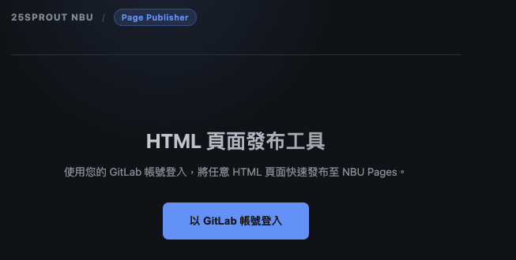
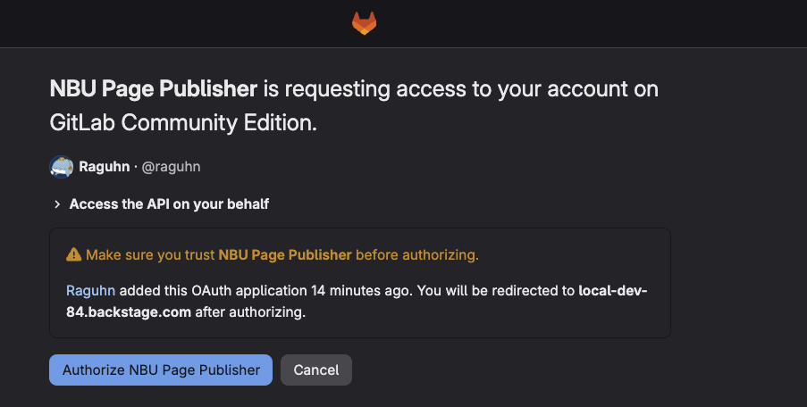
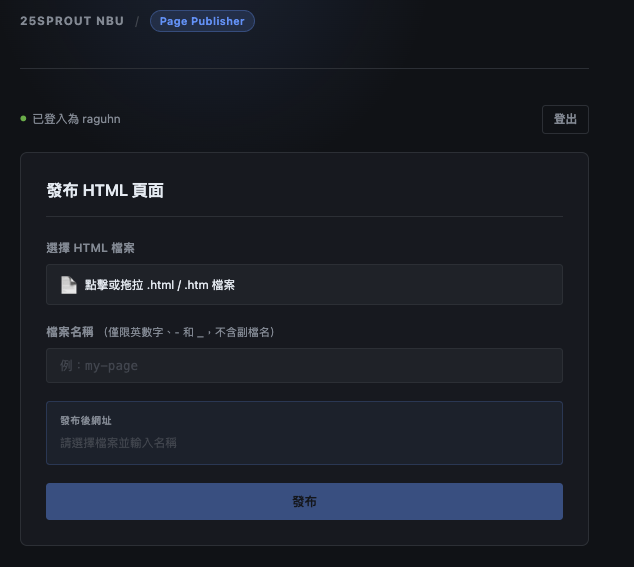
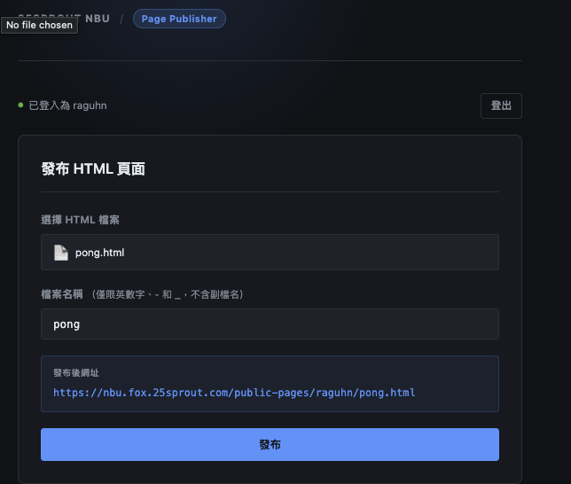
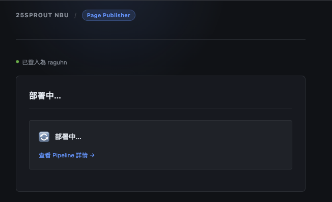
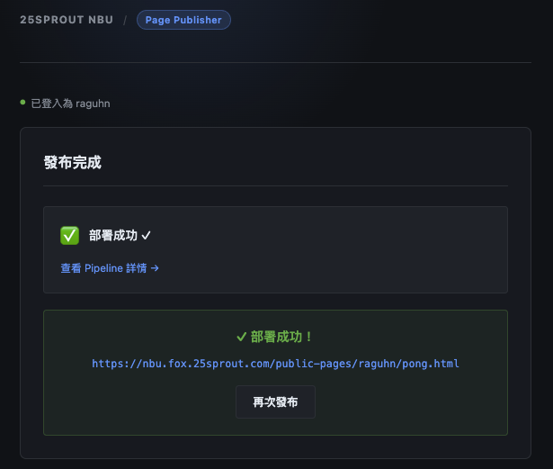

# HTML 頁面發布工具 (Publisher)

**工具網址**：[`https://nbu.fox.25sprout.com/public-pages/publisher/`](https://nbu.fox.25sprout.com/public-pages/publisher/)

## 步驟 1：開啟 Publisher 頁面

前往 [`https://nbu.fox.25sprout.com/public-pages/publisher/`](https://nbu.fox.25sprout.com/public-pages/publisher/)。

進入頁面後，預設顯示未登入狀態，發布功能暫時鎖定。



---

## 步驟 2：以 GitLab 帳號登入

點擊 **「以 GitLab 帳號登入」** 按鈕。

瀏覽器會導向 GitLab OAuth 授權頁面，確認授權應用程式存取你的帳號。



點擊 **Authorize** 後，頁面自動跳回 Publisher 並顯示已登入的帳號名稱。



---

## 步驟 3：選擇檔案並指定頁面名稱

1. 點擊 **「選擇 HTML 檔案」** 或拖曳你的 `.html` 檔案至上傳區域。
2. 在 **「頁面名稱（不含副檔名）」** 欄位輸入想要的名稱，例如 `my-report`。

命名規則：
- 只允許英文字母、數字、`-`、`_`
- 不可包含空格、中文、路徑符號（`/`、`..`）

發布後網址預覽會即時更新：

```
https://nbu.fox.25sprout.com/public-pages/{你的帳號}/my-report.html
```



> **⚠️ 若相同名稱的頁面已存在，再次發布會直接覆蓋舊版本，網址不變但內容更新。**

---

## 步驟 4：點擊發布

確認無誤後，點擊 **「發布」** 按鈕。

系統會依序執行：
1. 將 HTML 檔案 commit 至 `nbu/public-pages` 專案
2. 自動觸發 GitLab CI/CD pipeline
3. 即時顯示 pipeline 執行進度



---

## 步驟 5：部署完成，取得網址

Pipeline 執行成功後，頁面會顯示「🎉 部署成功！」並列出可存取的網址。

點擊網址即可開啟你剛發布的頁面。


